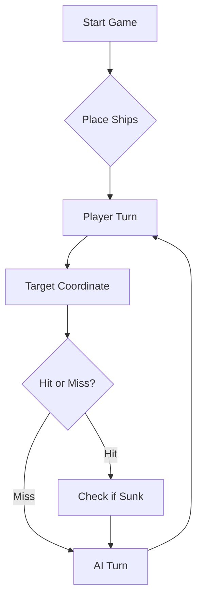

# ⚓ Battleship 2.0


> A modern take on the classic naval warfare game, designed for the XVII century setting with updated software engineering patterns.

---

## 📖 Table of Contents
- [Project Overview](#-project-overview)
- [Key Features](#-key-features)
- [Technical Stack](#-technical-stack)
- [Installation & Setup](#-installation--setup)
- [Code Architecture](#-code-architecture)
- [Roadmap](#-roadmap)
- [Contributing](#-contributing)

---

## 🎯 Project Overview
This project serves as a template and reference for students learning **Object-Oriented Programming (OOP)** and **Software Quality**. It simulates a battleship environment where players must strategically place ships and sink the enemy fleet.

### 🎮 The Rules
The game is played on a grid (typically 10x10). The coordinate system is defined as:

$$(x, y) \in \{0, \dots, 9\} \times \{0, \dots, 9\}$$

Hits are calculated based on the intersection of the shot vector and the ship's bounding box.

---

## ✨ Key Features
| Feature | Description | Status |
| :--- | :--- | :---: |
| **Grid System** | Flexible $N \times N$ board generation. | ✅ |
| **Ship Varieties** | Galleons, Frigates, and Brigantines (XVII Century theme). | ✅ |
| **AI Opponent** | Heuristic-based targeting system. | 🚧 |
| **Network Play** | Socket-based multiplayer. | ❌ |

---

## 🛠 Technical Stack
* **Language:** Java 17
* **Build Tool:** Maven / Gradle
* **Testing:** JUnit 5
* **Logging:** Log4j2

---

## 🚀 Installation & Setup

### Prerequisites
* JDK 17 or higher
* Git

### Step-by-Step
1. **Clone the repository:**
   ```bash
   git clone [https://github.com/britoeabreu/Battleship2.git](https://github.com/britoeabreu/Battleship2.git)
   ```
2. **Navigate to directory:**
   ```bash
   cd Battleship2
   ```
3. **Compile and Run:**
   ```bash
   javac Main.java && java Main
   ```

---

## 📚 Documentation

You can access the generated Javadoc here:

👉 [Battleship2 API Documentation](https://britoeabreu.github.io/Battleship2/)


### Core Logic
```java
public class Ship {
    private String name;
    private int size;
    private boolean isSunk;

    // TODO: Implement damage logic
    public void hit() {
        // Implementation here
    }
}
```

### Design Patterns Used:
- **Strategy Pattern:** For different AI difficulty levels.
- **Observer Pattern:** To update the UI when a ship is hit.
</details>

### Logic Flow


---

## 🗺 Roadmap
- [x] Basic grid implementation
- [x] Ship placement validation
- [ ] Add sound effects (SFX)
- [ ] Implement "Fog of War" mechanic
- [ ] **Multiplayer Integration** (High Priority)

---

## 🧪 Testing
We use high-coverage unit testing to ensure game stability. Run tests using:
```bash
mvn test
```

> [!TIP]
> Use the `-Dtest=ClassName` flag to run specific test suites during development.

---

## 🤖 AI Prompt

```
Considere agora a seguinte tática. Vai jogar num papel: ataca a frota do jogador com rajadas de 3 tiros. Só existe uma frota (a do jogador).

1. TABULEIRO E NAVIOS
- Tabuleiro 10x10: linhas A a J, colunas 1 a 10.
- Frota (11 navios): 4 Barcas (1 posição), 3 Caravelas (2), 2 Naus (3), 1 Fragata (4), 1 Galeao (5).
- Barca, Caravela, Nau e Fragata são linhas retas, na horizontal ou na vertical.
- O Galeao tem forma de T: um corpo de 3 posições em linha e, numa das extremidades, uma posição adicional de cada lado (as "asas"). Tem 4 orientações (braço do T virado a Norte, Sul, Este ou Oeste). Exemplo com o braço a Norte: B4, B5, B6 (asas e centro) e C5, D5 (restante corpo).
- Os navios nunca se tocam, nem nos cantos (diagonais), mas podem encostar às margens do tabuleiro.
- Consequência: à volta de cada navio há sempre um halo de 1 posição (incluindo diagonais) que é água.

2. FORMATO DAS MENSAGENS
- Em cada turno escreva, por esta ordem: (a) o Diário de Bordo atualizado, curto, e (b) a última linha, exatamente neste formato:
  RAJADA: A5 C10 F5
- A rajada tem exatamente 3 coordenadas distintas (letra de A a J seguida de número de 1 a 10), separadas por espaços. Não escreva mais nada depois desta linha.

3. COMO LER O RELATÓRIO DE UMA RAJADA
- validShots + repeatedShots + outsideShots = 3.
- Dentro dos válidos: afundados (sunkBoats), acertos em navios que continuam a flutuar (hitsOnBoats) e água (missedShots).
- O relatório NÃO diz que tiro fez o quê. Se missedShots = 3, as três posições são água certa. Se os 3 tiros foram acertos ou afundamentos, as três são navio. Nos outros casos, registe um grupo ambíguo, por exemplo: "G1: 1 acerto em Nau entre {B6, F2, H9}". Nunca decida ao acaso qual dos tiros acertou.
- Resolva os grupos ambíguos por eliminação: dispare nas posições contíguas dos candidatos; um candidato fica confirmado quando um vizinho também acerta, ou quando os restantes do grupo ficam descartados.
- O campo "type" diz de que navio se trata. Use-o e use a contagem de navios que ainda flutuam: se já não restam Caravelas, um acerto novo nunca é Caravela.

4. DIÁRIO DE BORDO (atualize em cada rajada)
- Rajada N: os 3 tiros, o resumo do relatório e as deduções (certezas e grupos ambíguos).
- Mapa 10x10: "." desconhecido, "~" água certa, "?" candidato a acerto, "X" acerto confirmado, "#" navio afundado.
- Navios por afundar, por tipo (começa com 1 Galeao, 1 Fragata, 2 Naus, 3 Caravelas, 4 Barcas).
- Só marque "~" ou "#" com certeza. Se não tiver, use "?".

5. REGRAS DE DISPARO
- Nunca dispare fora do mapa, numa posição já disparada, nem em água certa.
- Única exceção: a última rajada do jogo, quando todos os navios já estiverem afundados, só para perfazer os 3 tiros.
- Prioridade: (1) acabar de afundar os navios atingidos, (2) resolver grupos ambíguos, (3) procurar novos navios.
- Se um acerto está confirmado, dispare nas posições contíguas (N, S, E, O). Com dois acertos alinhados, continue pela linha nas duas extremidades. Se um extremo for água, vá ao extremo oposto. Se tiver menos de 3 alvos úteis, complete com tiros de procura.
- Diagonais: se o navio atingido for Barca, Caravela, Nau ou Fragata, as diagonais dos acertos são água certa. Se for Galeao (ou o tipo for ambíguo e o Galeao ainda flutuar), NÃO marque diagonais como água, porque no T uma diagonal pode ser navio.
- Galeao: se tiver 3 acertos em linha, pode ser o corpo ou o braço do T; teste as posições laterais numa das extremidades para encontrar as asas. Descarte as orientações incompatíveis com a água já conhecida ou com as margens.
- Procura: dispare em xadrez, com A=1, B=2, ..., J=10, escolhendo posições em que (linha + coluna) é par, e com os 3 tiros afastados entre si. Prefira posições onde caiba pelo menos um navio que ainda flutue. Quando só restarem Barcas, varra as posições desconhecidas que sobram, incluindo as de paridade ímpar.

6. NAVIO AFUNDADO
- Use o tamanho do navio e o Diário para identificar as posições que o formam e marque-as "#".
- Só então marque o halo de 1 posição em redor (incluindo diagonais) como "~". Se ainda houver ambiguidade sobre as posições do navio, marque apenas o que é certo.

7. ANTES DE ENVIAR, CONFIRME
- 3 posições distintas, com letras A a J e números de 1 a 10.
- Nenhuma foi disparada antes nem está marcada "~" ou "#".
- O Diário e o mapa estão atualizados com o último relatório.
- A última linha da resposta é "RAJADA: ..." no formato indicado.

8. FIM DO JOGO
- Quando não restar nenhum navio por afundar, seja um vencedor magnânimo e não envie mais rajadas.
- Se a sua frota for afundada, declare a derrota com honra.

EXEMPLO
Rajada 1: A1 C4 E8 -> missedShots 3 -> as três posições são água certa "~".
Rajada 2: B6 F2 H9 -> hitsOnBoats [{"hits":1,"type":"Nau"}], missedShots 2 -> G1: 1 acerto em Nau entre {B6, F2, H9}. Ainda não sabe qual.
Rajada 3: um vizinho de cada candidato (B7, F3, H10) para descobrir qual deles pertence à Nau.
RAJADA: B7 F3 H10
```

## 🤝 Contributing
Contributions are what make the open-source community such an amazing place to learn, inspire, and create.

1. Fork the Project
2. Create your Feature Branch (`git checkout -b feature/AmazingFeature`)
3. Commit your Changes (`git commit -m 'Add some AmazingFeature'`)
4. Push to the Branch (`git push origin feature/AmazingFeature`)
5. Open a **Pull Request**

---

## 📄 License
Distributed under the MIT License. See `LICENSE` for more information.

---
**Maintained by:** [@britoeabreu](https://github.com/britoeabreu)  
*Created for the Software Engineering students at ISCTE-IUL.*
