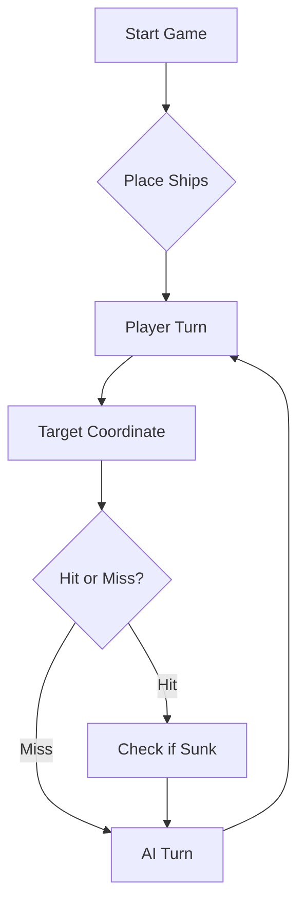

# ⚓ Battleship 2.0


> A modern take on the classic naval warfare game, designed for the XVII century setting with updated software engineering patterns.

---

## 📖 Table of Contents
- [Project Overview](#-project-overview)
- [Key Features](#-key-features)
- [Technical Stack](#-technical-stack)
- [Installation & Setup](#-installation--setup)
- [Code Architecture](#-code-architecture)
- [Roadmap](#-roadmap)
- [Contributing](#-contributing)

---

## 🎯 Project Overview
This project serves as a template and reference for students learning **Object-Oriented Programming (OOP)** and **Software Quality**. It simulates a battleship environment where players must strategically place ships and sink the enemy fleet.

### 🎮 The Rules
The game is played on a grid (typically 10x10). The coordinate system is defined as:

$$(x, y) \in \{0, \dots, 9\} \times \{0, \dots, 9\}$$

Hits are calculated based on the intersection of the shot vector and the ship's bounding box.

---

## ✨ Key Features
| Feature | Description | Status |
| :--- | :--- | :---: |
| **Grid System** | Flexible $N \times N$ board generation. | ✅ |
| **Ship Varieties** | Galleons, Frigates, and Brigantines (XVII Century theme). | ✅ |
| **AI Opponent** | Heuristic-based targeting system. | 🚧 |
| **Network Play** | Socket-based multiplayer. | ❌ |

---

## 🛠 Technical Stack
* **Language:** Java 17
* **Build Tool:** Maven / Gradle
* **Testing:** JUnit 5
* **Logging:** Log4j2

---

## 🚀 Installation & Setup

### Prerequisites
* JDK 17 or higher
* Git

### Step-by-Step
1. **Clone the repository:**
   ```bash
   git clone [https://github.com/britoeabreu/Battleship2.git](https://github.com/britoeabreu/Battleship2.git)
   ```
2. **Navigate to directory:**
   ```bash
   cd Battleship2
   ```
3. **Compile and Run:**
   ```bash
   javac Main.java && java Main
   ```

---

## 📚 Documentation

You can access the generated Javadoc here:

👉 [Battleship2 API Documentation](https://britoeabreu.github.io/Battleship2/)


### Core Logic
```java
public class Ship {
    private String name;
    private int size;
    private boolean isSunk;

    // TODO: Implement damage logic
    public void hit() {
        // Implementation here
    }
}
```

### Design Patterns Used:
- **Strategy Pattern:** For different AI difficulty levels.
- **Observer Pattern:** To update the UI when a ship is hit.
</details>

### Logic Flow


---

## 🗺 Roadmap
- [x] Basic grid implementation
- [x] Ship placement validation
- [ ] Add sound effects (SFX)
- [ ] Implement "Fog of War" mechanic
- [ ] **Multiplayer Integration** (High Priority)

---

## 🧪 Testing
We use high-coverage unit testing to ensure game stability. Run tests using:
```bash
mvn test
```

> [!TIP]
> Use the `-Dtest=ClassName` flag to run specific test suites during development.

---

## 🤖 AI Prompt

```
Considere agora a seguinte tática. Vai jogar num papel: ataca a frota do jogador com rajadas de 3 tiros, diferente da batalha naval tradicional onde ha duas frotas.

1. FORMATO DAS MENSAGENS
- As suas rajadas são sempre um array de coordenadass com exatamente 3 tiros, por exemplo:
  [A5,C10,F5]
  "row" é uma letra maiúscula de A a J e "column" um número de 1 a 10.
- Em cada turno de ataque responda por esta ordem: (a) o Diário de Bordo atualizado e (b) um único array com as rajadas. Não escreva mais nada.

2. COMO LER O RELATÓRIO DE UMA RAJADA
- Os 3 tiros dividem-se em: validShots + repeatedShots + outsideShots = 3.
- Dentro dos tiros válidos: os que afundaram um navio (sunkBoats), os acertos em navios que continuam a flutuar (hitsOnBoats) e os tiros na água (missedShots).
- O relatório NÃO diz que tiro fez o quê. Se missedShots = 3, as três posições são água certa. Se os 3 tiros foram acertos ou afundamentos, as três são navio. Nos outros casos, registe um grupo ambíguo, por exemplo: "G1: 1 acerto em Nau entre {B6, F2, H9}". Nunca decida ao acaso qual dos tiros acertou.
- Resolva os grupos ambíguos por eliminação: dispare nas posições contíguas dos candidatos; um candidato fica confirmado quando um vizinho também acerta, ou quando os restantes do grupo ficam descartados. O tipo e o tamanho do navio também ajudam (Barca 1, Caravela 2, Nau 3, Fragata 4, Galeao 5).

3. DIÁRIO DE BORDO (atualize-o em cada rajada)
- Rajada N: os 3 tiros, o resumo do relatório e as deduções (certezas e grupos ambíguos).
- Mapa 10x10 com estes símbolos: "." desconhecido, "~" água certa, "?" candidato a acerto, "X" acerto confirmado, "#" navio afundado.
- Navios por afundar, por tipo (começa com 1 Galeao, 1 Fragata, 2 Naus, 3 Caravelas, 4 Barcas).
- Só marca "~" ou "#" quando tiver certeza. Quando não tiver, use "?".

4. REGRAS DE DISPARO
- Nunca dispare fora do mapa, nem numa posição já disparada, nem em água certa. Única exceção: quando restarem menos de 3 posições úteis, complete a rajada com posições repetidas.
- Prioridade: (1) acabar de afundar os navios atingidos, (2) resolver grupos ambíguos, (3) procurar novos navios.
- Se um acerto está confirmado, dispare nas posições contíguas (Norte, Sul, Este, Oeste). Com dois acertos alinhados, continue pela linha, nas duas extremidades. Se tiver menos de 3 alvos úteis, complete com tiros de procura.
- Navios nunca se tocam, nem nos cantos: as diagonais de um acerto são água certa. Exceção: o Galeao tem forma de T, por isso, se os acertos formarem um L ou um T, uma diagonal pode ser navio.
- Procura: dispare em xadrez (linha + coluna par), com os 3 tiros afastados entre si, porque os navios de 2 ou mais posições ocupam sempre uma casa de cada cor. Quando só restarem Barcas (1 posição), varra as posições desconhecidas que sobram.

5. NAVIO AFUNDADO
- Quando o relatório indicar um afundamento, use o tamanho do navio e o Diário para identificar exatamente as posições que o formam, e marque-as "#".
- Só então marque as posições adjacentes (o halo de 1 posição em redor, incluindo as diagonais) como água certa "~". Se ainda houver ambiguidade sobre as posições do navio, marque apenas o que é certo.

6. ANTES DE ENVIAR UMA RAJADA, CONFIRME
- Tem 3 posições distintas, com letras A a J e números de 1 a 10.
- Nenhuma foi disparada antes nem está marcada "~" ou "#" (salvo a exceção da última rajada).
- O Diário e o mapa estão atualizados com o último relatório.

7. FIM DO JOGO
- Se for a frota inimiga, seja um vencedor magnânimo.

EXEMPLO
Rajada 1: [A1, C4, E8] -> missedShots 3 -> as três posições são água certa "~".
Rajada 2: [B6, F2, H9] -> hitsOnBoats [{"hits":1,"type":"Nau"}], missedShots 2 -> G1: 1 acerto em Nau entre {B6, F2, H9}. Ainda não sabe qual.
Rajada 3: um vizinho de cada candidato, B7, F3 e H10, para descobrir qual deles pertence à Nau.
```

## 🤝 Contributing
Contributions are what make the open-source community such an amazing place to learn, inspire, and create.

1. Fork the Project
2. Create your Feature Branch (`git checkout -b feature/AmazingFeature`)
3. Commit your Changes (`git commit -m 'Add some AmazingFeature'`)
4. Push to the Branch (`git push origin feature/AmazingFeature`)
5. Open a **Pull Request**

---

## 📄 License
Distributed under the MIT License. See `LICENSE` for more information.

---
**Maintained by:** [@britoeabreu](https://github.com/britoeabreu)  
*Created for the Software Engineering students at ISCTE-IUL.*
